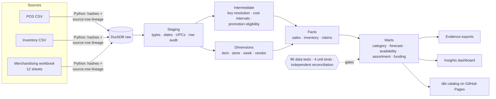

# Bramblewood Retail Analytics Warehouse

**Turning disconnected POS, inventory and merchandising extracts into a tested, auditable retail warehouse — built with dbt, DuckDB, SQL and Python.**

[](https://github.com/Akshith597/bramblewood-analytics-engineering/actions/workflows/ci.yml)
[](https://akshith597.github.io/bramblewood-analytics-engineering/)


[](LICENSE)

**[📊 Live insights dashboard](https://akshith597.github.io/bramblewood-analytics-engineering/insights.html)** · **[🧭 Interactive dbt catalog & lineage](https://akshith597.github.io/bramblewood-analytics-engineering/)** · **[📄 Two-minute case study](docs/case_study.md)**

> **Synthetic portfolio project.** All companies and transactions are fictional. Figures describe the supplied dataset; they are not real client outcomes, recovered funds or realized savings.

## At a glance

| | |
|---|---|
| **Scope** | 24 stores · 151 SKUs · 104 fiscal weeks · 14 source tables (2 CSVs + 12 workbook sheets) |
| **Warehouse** | 35 dbt models across staging → intermediate → marts, 13 enforced contracts, 370 typed and documented columns |
| **Quality gates** | 96 data tests + 4 unit tests, independent Python reconciliation, full-rebuild repeatability, SQLFluff, CI |
| **Trust result** | 273,376 POS rows → 273,262 accepted, every exclusion classified; **$21,886,423.88** net sales reconciled for all 2,427 store-weeks |
| **Business output** | Category, forecast-accuracy, availability, assortment and vendor-funding marts, plus a dashboard rebuilt on every push |

## What the data says

Every chart below is rendered by [`scripts/build_insights.py`](scripts/build_insights.py) directly from the tested marts on each build — no hand-edited numbers.


Holiday weeks (Super Bowl, July 4th, Labor Day, Christmas) create the demand spikes. FY2025 net sales are **$11.30M vs $10.59M**, but the chain added a 24th store, so this is not same-store growth.


Growth concentrated in **Trail Mix (+32%)** and **Kettle Chips (+14%)**, while **Nuts lost 3.0 pp of margin** and Potato Chips — the largest subcategory — lost 1.9 pp. Margins are before vendor funding.


The chain forecast **over-forecasts in every period** (FY2025 bias +13.4%, WAPE 22.5%). The chart keeps two-week-lead forecasts only, so FY2024's startup horizons don't distort the trend; actuals may be stock-constrained.


Approved promotions imply **$1.25M of contractual funding versus $1.12M billed** — a **$132,975 review queue**, led by Crispwell Foods. This assumes approved events executed as planned; it is not recovered cash. [Waterfall](evidence/funding_waterfall.csv) · [Sensitivity](evidence/funding_assumption_sensitivity.csv) · [Exception queue](evidence/funding_exception_queue.csv)

## The problem

POS identifies products by UPC and week-ending date. Inventory uses SKU and fiscal week. Merchandising supplies effective-dated prices, costs and planograms. Joining them naively creates duplicate revenue, misaligned dates, temporal-join fanout and misleading metrics.

The objective is a **reproducible, auditable warehouse that business users can query safely** — with every cleaning decision traceable and every ambiguity left visible rather than silently "fixed".

## Architecture



Design decisions are recorded as ADRs in [docs/architecture.md](docs/architecture.md); grains and metric definitions are in [docs/data_contracts.md](docs/data_contracts.md).

## Engineering decisions that mattered

| Source issue | Decision | Verified result |
|---|---|---|
| Concatenated POS feeds | Classify every row; remove exact replays only | 113 replay rows (**$8,489.86**) excluded; one embedded header retained in audit |
| Inconsistent product/date formats | String UPC normalization and two explicit date formats | 30,985 UPCs padded; 83,351 legacy-format dates parsed |
| Overlapping cost history | Latest-start precedence; original dates kept with an exception flag | 34 affected sales rows; **$29.12 COGS sensitivity** disclosed |
| Return transactions | Preserve signed units and amounts | 160 return rows retained instead of dropped as "invalid" |
| Inventory without sales | Keep both sides with presence flags | 1,888 inventory-only observations remain visible |
| Forecast at chain grain | Aggregate actuals to chain SKU-week before joining | No store-level fanout in forecast measures |
| Many claims per promotion | Aggregate claims and eligible units before joining funding terms | Funding gap computed without double counting; cancelled-event claims ($974.65) kept separate |

The most instructive failure: the cost-overlap test initially failed for `SS-1081`, whose old cost ended two weeks *after* the new one began. A direct join would have duplicated sales rows and inflated revenue. The full story is in the [case study](docs/case_study.md#the-most-instructive-failure).

## Validation

- **100/100 dbt checks pass** — 96 SQL data tests and 4 unit tests. [Build receipt](evidence/dbt_build_results.json)
- **Independent reconciliation** — Python `csv` + `Decimal` totals match dbt for every store-week, without reusing the transformation SQL. [Receipt](evidence/independent_reconciliation.json)
- **Governance enforced in code** — layer boundaries, staged-source coverage, contracts and column documentation are checked against the dbt manifest. [Receipt](evidence/project_quality.json)
- **Repeatability** — ordered contents of all 35 models are hashed before and after a full reload. [Receipt](evidence/repeatability.json)
- **Code quality** — dbt-aware SQLFluff, pre-commit hooks, macro edge-case tests and chart-helper tests. [Lint receipt](evidence/sqlfluff.json)
- **CI/CD** — GitHub Actions runs every gate on each push; the docs site and dashboard deploy only after the build and reconciliation pass.

## Run it locally

Python 3.12; no cloud account or credentials required.

```bash
python -m venv .venv
# Windows: .venv\Scripts\Activate.ps1   macOS/Linux: source .venv/bin/activate
python -m pip install -r requirements-dev.txt
python scripts/run_all.py               # ingest → dbt build → reconcile → docs → evidence → charts
python scripts/verify_repeatability.py
python -m unittest discover -s tests_python -v
python scripts/lint_sql.py
```

Browse lineage and compiled SQL locally with `python scripts/invoke_dbt.py docs serve --port 8080`, and open `target/insights.html` for the dashboard. See the [runbook](docs/runbook.md) for troubleshooting.

## Repository map

```text
data/raw/             Synthetic CSV and Excel inputs (see data/SOURCE_README.md)
models/staging/       Parsing, normalization, row audit and unit fixtures
models/intermediate/  Key resolution, cost intervals and promotion eligibility
models/marts/         Dimensions, facts and business marts (contracts enforced)
tests/                Singular SQL assertions: temporal, arithmetic, reconciliation
tests_python/         Macro, evidence-reference and chart-helper guards
macros/               UPC normalization and a generic period-overlap test
scripts/              Ingest, build, verification, evidence export and charts
docs/                 Case study, architecture ADRs, data contracts, runbook, figures
evidence/             Executed results and machine-readable validation receipts
.github/workflows/    CI quality gate and GitHub Pages deployment
```

## Scope and limitations

This is a local batch warehouse, not a deployed production platform. It uses deliberate full rebuilds because the extracts lack reliable change timestamps. Item and store dimensions reflect the supplied current master; cost, price and planogram periods are effective-dated. Cost precedence is a documented assumption. A zero-stock snapshot does not establish lost sales, and approved promotion eligibility does not establish realized lift or funding entitlement.

Next production steps: source-owner resolution of exceptions, validated incremental restatement, isolated build/publish schemas and freshness monitoring. See the [design decisions](docs/architecture.md) for the tradeoffs.

## Author

**Akshith Reddy** · [GitHub @Akshith597](https://github.com/Akshith597) · feedback welcome via [issues](https://github.com/Akshith597/bramblewood-analytics-engineering/issues)

Project code is released under the [MIT License](LICENSE). The synthetic dataset in `data/` is third-party material described in [data/SOURCE_README.md](data/SOURCE_README.md) and is not covered by that license.
