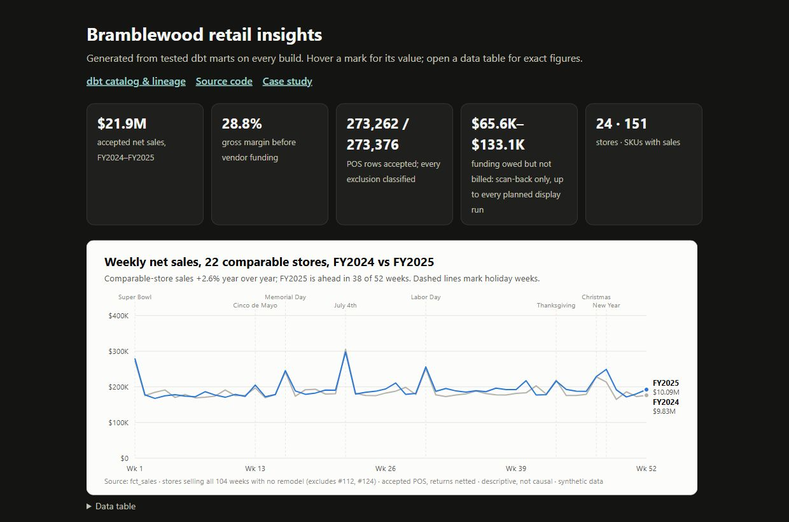
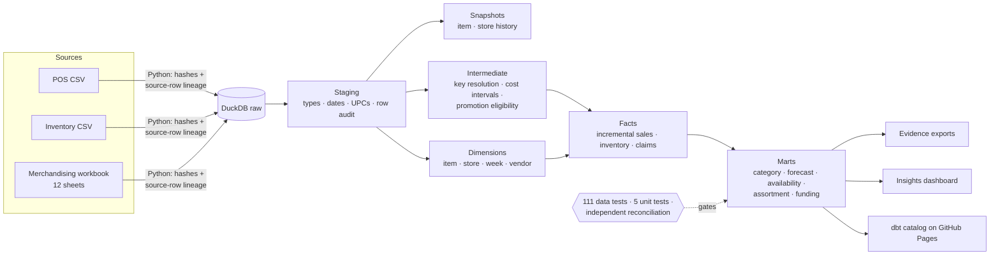

# Bramblewood Retail Analytics Warehouse

**Turning disconnected POS, inventory and merchandising extracts into a tested, auditable retail warehouse — built with dbt, DuckDB, SQL and Python.**

Built to help merchandising and finance compare store performance, assess inventory availability, and investigate vendor-funding billing gaps using reconciled measures.

[](https://github.com/Akshith597/bramblewood-analytics-engineering/actions/workflows/ci.yml)
[](https://akshith597.github.io/bramblewood-analytics-engineering/)


[](LICENSE)

**[🧭 Interactive dbt catalog & lineage](https://akshith597.github.io/bramblewood-analytics-engineering/)** · **[📊 Live dashboard](https://akshith597.github.io/bramblewood-analytics-engineering/insights.html)** · **[📄 Case study](docs/case_study.md)** · **[🏛️ Design decisions](docs/architecture.md)**

> **Synthetic portfolio project.** The dataset was generated by AI ([provenance](data/SOURCE_README.md)); all companies and transactions are fictional.

<!-- Generated by analysis/build_public.py from analysis/readme_template.md. Do not edit README.md by hand: CI regenerates it and fails on any difference. -->

## At a glance

| | |
|---|---|
| **What I built** | A dbt warehouse that turns three disagreeing retail extracts into reconciled, contract-enforced facts and marts, rebuilt and verified by CI on every change |
| **Stack** | SQL · dbt-core · DuckDB · Python (ingestion and verification) · GitHub Actions · GitHub Pages |
| **Data** | 273,376 POS rows, weekly store inventory and a 12-sheet merchandising workbook: 24 stores, 104 weeks, keys and date formats that don't agree |
| **Warehouse** | 35 dbt models, an incremental sales fact, Type 2 snapshots, 13 enforced contracts, 116 automated checks; sales reconciled to the cent against an independent rebuild |
| **Reviewer path** | About ten minutes: [design](#warehouse-design) → [three decisions](#three-engineering-decisions) → [validation](#validation) → the [lineage graph](https://akshith597.github.io/bramblewood-analytics-engineering/) |

[](https://akshith597.github.io/bramblewood-analytics-engineering/insights.html)

*Static dashboard preview captured on `2026-10-21`. Open the [live dashboard](https://akshith597.github.io/bramblewood-analytics-engineering/insights.html) for the current build, exact data tables and metric definitions.*

## The problem

A fictional 24-store grocer's POS, inventory and merchandising systems disagree on keys, date formats and grain, and prices and costs change over time. Joined naively, they duplicate revenue and attach the wrong cost to a sale.

## Warehouse design



Only staging models read raw sources, intermediate models never read marts, and every mart has an enforced contract; CI checks these rules against the dbt manifest. Grains and metric definitions: [data contracts](docs/data_contracts.md). All design decisions: [architecture ADRs](docs/architecture.md).

## Three engineering decisions

### 1. Classify every POS row; remove only exact replays

The POS extract is two feeds concatenated: 113 rows repeat another row field for field (**$8,489.86**), and one header line sits inside the data. Every raw row gets exactly one disposition in the [row audit](models/staging/stg_pos_audit.sql). Replays are ranked on the raw fields *before* normalization, so only true copies are dropped and the earliest source row wins:

```sql
        row_number() over (
            partition by store_nbr, upc, week_ending, units, gross_sales, promo_discount, net_sales
            order by _source_row
        ) as replay_number
```

Result: 273,376 rows in, 273,262 accepted, every exclusion labelled and traceable to its source row. A remaining conflict on the normalized store × SKU × week key fails a uniqueness test instead of being summed.

### 2. Close overlapping cost periods instead of joining both

The cost-overlap test failed for `SS-1081`, whose old cost ended two weeks *after* the new one began; a direct join would have duplicated sales rows. [`int_item_cost_intervals`](models/intermediate/int_item_cost_intervals.sql) ends each period the day before the next starts and keeps the source dates and a flag:

```sql
    case
        when next_start is not null and (effective_end is null or effective_end >= next_start)
            then next_start - 1
        else effective_end
    end as effective_end,
    next_start is not null and (effective_end is null or effective_end >= next_start) as overlap_adjusted,
```

Result: 34 sales rows affected and a **$29.12** COGS sensitivity disclosed. [The full story](docs/case_study.md#the-most-instructive-failure)

### 3. Restate a date window in the incremental sales fact

[`fct_sales`](models/marts/fct_sales.sql) is incremental. A [pre-hook](macros/restate_sales_window.sql) deletes every week inside the lookback of the latest source week, then the model appends every row newer than what remains. Changed rows, deleted rows and whole deleted weeks are all restated, and an empty target loads in full:

```sql
        delete from {{ this }}
        where week_ending > (
            select max(week_ending) - {{ var('sales_restatement_lookback_days', 28) }}
            from {{ ref('int_sales_enriched') }}
        )
-- ...

    where week_ending > (
        select coalesce(max(week_ending), date '1900-01-01')
        from {{ this }}
    )

```

Result: [`verify_incremental.py`](scripts/verify_incremental.py) changes an amount, deletes rows, deletes a week and empties the target on copies of the warehouse; each must match a full rebuild. Run against this model's first version, it caught two real bugs: deleted weeks stayed loaded, and an empty target loaded nothing. Other source issues and their fixes are in the [data contracts](docs/data_contracts.md#source-normalization-and-exception-policy).

## Validation

- **116/116 dbt checks pass** — 111 data tests and 5 unit tests, plus 13 enforced mart contracts. [Receipt](evidence/dbt_build_results.json)
- **Sales tie out to the cent** — $21,886,423.88 across 2,427 store-weeks matches an [independent rebuild](scripts/independent_reconcile.py) that reads the raw CSV with Python `Decimal`, without the transformation SQL. [Receipt](evidence/independent_reconciliation.json)
- **Incremental loads are correct** — unchanged input rebuilds identically ([receipt](evidence/repeatability.json)); changed input matches a full rebuild ([receipt](evidence/incremental_changes.json)).
- **Bad input fails loudly** — blank stock quantities fail a not-null contract, swapped promotion dates are reordered and flagged, and two extracts mapping to one raw table are rejected before loading; each guard has its own test.
- **README figures are generated and checked** — this README's text is rendered from committed results and build evidence, CI fails on any difference, and a test checks each SQL excerpt above against its source file. The dashboard preview is a dated screenshot; the live dashboard is rebuilt from the marts.

## How I built this

I built this with AI assistance (Claude Code), and Claude co-authored many commits; the history links to those sessions. My role was to set the requirements and design choices, direct the implementation, and verify the results.

**A decision I owned: POS replay classification** (decision 1 above).

- **Requirement I set:** no source row may disappear silently, and sales must tie back to the raw file to the cent.
- **Alternatives I weighed:** `SELECT DISTINCT` (drops copies but loses which row survived and why); de-duplicating on store × UPC × week (would silently keep one of two rows that *disagree*); keeping everything (double counts revenue).
- **What the data showed:** the replays were exact field-for-field copies from the concatenated feeds, plus one embedded header line that would otherwise look like an invalid sales row.
- **How I verified it:** a test that every raw row is counted in exactly one disposition, the reconciliation test on `fct_sales`, and the independent `Decimal` rebuild across 2,427 store-weeks.

## Explore further

- **Interview walkthrough:** a [five-minute outline and SQL practice exercise](docs/interview_walkthrough.md) covering the decisions, verification and limits.

- **Run it locally** (Python 3.12, no credentials): `pip install -r requirements-dev.txt`, then `python scripts/run_all.py`. The [runbook](docs/runbook.md) has every command.
- **Optional statistics extension:** the [business analysis](docs/business_analysis.md) answers the brief's five questions with scenario estimates. It is separate on purpose; the warehouse above is the core work.
- **Operations drill:** a weekly [recovery drill](docs/runbook.md#scheduled-recovery-drill) on GitHub Actions publishes a release, detects a stale source, rejects a tampered batch without moving the release pointer, and recovers with a fresh batch. It runs on GitHub's runners and is a drill, not a production deployment.

## Scope

A local batch warehouse that demonstrates modeling, testing and verification. It has no live scheduler, access control, monitoring or alert delivery, so it does not show production operating experience. Limitations and tradeoffs are in the [design decisions](docs/architecture.md).

## Author

**Akshith Reddy** · [Another project: Meridian sales performance](https://akshith597.github.io/meridian_sales_portfolio/) · [GitHub @Akshith597](https://github.com/Akshith597)

Code: [MIT License](LICENSE). The AI-generated dataset in `data/` is not covered by that license; see [data/SOURCE_README.md](data/SOURCE_README.md).
