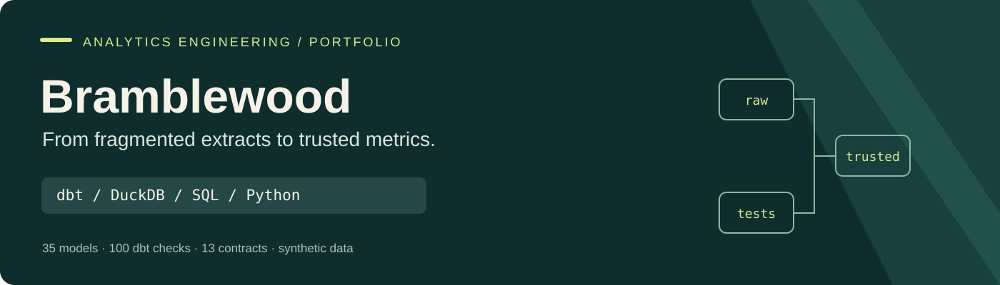

# Bramblewood Retail Analytics Warehouse

**A reproducible analytics engineering portfolio project using dbt, DuckDB, SQL and Python.**

Turn disconnected retail extracts into tested, documented business marts. The project demonstrates grain-aware modeling, temporal joins, auditability, metric definitions and automated quality gates using a fictional 24-store grocer.

**35 models · 96 data tests · 4 unit tests · 13 enforced contracts · 14 sources**

[](https://github.com/Akshith597/bramblewood-analytics-engineering/actions/workflows/ci.yml)

[Interactive dbt catalog](https://akshith597.github.io/bramblewood-analytics-engineering/) · [GitHub repository](https://github.com/Akshith597/bramblewood-analytics-engineering)

> **Synthetic portfolio project.** All companies and transactions are fictional. Financial figures describe the supplied dataset; they are not real client outcomes, recovered funds or realized savings.

## Start here

| Reader | Best first stop |
|---|---|
| Recruiter or hiring manager | [Two-minute case study](docs/case_study.md) |
| Analytics engineering reviewer | [Architecture and decisions](docs/architecture.md) → [sales fact](models/marts/fct_sales.sql) |
| Data consumer | [Model grains and metric contracts](docs/data_contracts.md) |
| Hands-on reviewer | [Runbook](docs/runbook.md) → [saved build evidence](evidence/summary.json) |
| Project presenter | [Resume bullets and interview walkthrough](docs/interview_guide.md) |
| Ready to publish | [GitHub and GitHub Pages setup](docs/go_live.md) |

## The problem

POS identifies products by UPC and week-ending date. Inventory uses SKU and fiscal week. Merchandising supplies effective-dated prices, costs and planograms. Combining them directly creates opportunities for duplicate revenue, misaligned dates, temporal join fanout and misleading operational metrics.

The engineering objective is a **reproducible, auditable warehouse that business users can query safely**. The original dataset's analyst brief is background; this project concentrates on reliable modeling and descriptive validation rather than claiming unsupported causal findings.

## What was built

```text
2 CSVs + 12 workbook sheets
          │  Python ingestion, source hashes, source-row lineage
          ▼
    DuckDB raw schema
          │  dbt staging: dates, UPCs, replay handling, cost intervals
          ▼
  Conformed dimensions + sales / inventory / claims facts
          │  tested joins at explicit grains
          ▼
  Category · Forecast · Availability · Assortment · Funding marts
          │
          └── SQL evidence exports + dbt catalog + automated checks
```

## Evidence of engineering judgment

| Source issue | Implemented decision | Verified result |
|---|---|---|
| Concatenated POS feeds | Classify every row; remove exact replays only | 113 replay rows representing **$8,489.86** excluded; one embedded header retained in audit |
| Inconsistent product/date formats | String UPC normalization and two explicit date formats | 30,985 UPCs padded; 83,351 legacy-format dates parsed |
| Overlapping cost history | Latest-start precedence with original dates and exception flag | 34 affected sales rows; **$29.12 COGS sensitivity** versus prior-cost precedence |
| Return transactions | Preserve signed units and amounts | 160 return rows retained |
| Inventory without sales | Preserve both sides with presence flags | 1,888 inventory-only observations remain visible |
| Forecast at chain grain | Aggregate actuals before joining | Forecast measures avoid store-level fanout |
| Multiple claim/event relationships | Aggregate claims and eligible net units before joining funding terms | **$132,975.45 estimated owed-minus-billed gap** on approved events; cancellation and execution caveats remain visible |

Evidence and executed queries are in [`evidence/`](evidence/) and [`scripts/export_evidence.py`](scripts/export_evidence.py). The **$21,886,423.88** accepted net-sales total reconciles to raw inputs independently for all **2,427 store-weeks**.

## Run it

Python 3.12; no cloud account or credentials required.

```bash
python -m venv .venv
# Windows: .venv\Scripts\Activate.ps1
# macOS/Linux: source .venv/bin/activate
python -m pip install -r requirements-dev.txt
python scripts/run_all.py
python scripts/verify_repeatability.py
python -m unittest discover -s tests_python -v
python scripts/lint_sql.py
```

The pipeline loads the supplied data, builds/tests the models, checks source totals independently, generates dbt documentation and writes reviewable evidence. Full-rebuild repeatability compares every model's ordered contents.

To browse model lineage and compiled SQL:

```bash
python scripts/invoke_dbt.py docs serve --port 8080
```

## Validation

- **100/100 dbt checks passed:** 96 SQL data tests and 4 unit tests. [Build receipt](evidence/dbt_build_results.json)
- **Independent reconciliation passed:** Python `csv` + `Decimal` totals match dbt by every store and week. [Receipt](evidence/independent_reconciliation.json)
- **Machine-readable governance:** all 14 sources staged, 13 mart contracts enforced, 370 typed/described columns and 2 exposures. [Receipt](evidence/project_quality.json)
- **Repeatability checked:** ordered contents of all 35 project models compared before and after a full reload/build. [Receipt](evidence/repeatability.json)
- **Reusable guards:** UPC macro, one configurable inclusive-period overlap test, pinned dbt_utils and four independent macro edge-case checks.
- **Code-quality gates:** dbt-aware SQLFluff and local pre-commit hooks. [Lint receipt](evidence/sqlfluff.json)
- **Hosted CI:** GitHub Actions runs all of these gates and preserves the artifacts. [Workflow and runs](https://github.com/Akshith597/bramblewood-analytics-engineering/actions/workflows/ci.yml)

## Repository map

```text
data/raw/             Original synthetic CSV and Excel inputs
data/SOURCE_README.md  Original dataset context and attribution
models/staging/       Parsing, normalization, audit and unit fixtures
models/intermediate/  Key resolution and promotion eligibility
models/marts/         Dimensions, facts and business marts
tests/                SQL assertions, temporal and reconciliation tests
tests_python/         Independent macro edge-case guards
macros/               UPC normalization and generic period-overlap test
analyses/             Example dbt analysis SQL
scripts/              Ingest, build, evidence and independent validation
docs/                 Case study, architecture, contracts and interview pack
evidence/             Executed results and machine-readable validation receipts
.github/workflows/    CI quality gate
packages.yml          Pinned dbt_utils ecosystem dependency
package-lock.yml      Resolved dbt package dependency lock
warehouse/, target/   Generated locally; excluded from version control
```

## Scope and limitations

The project is a local batch warehouse, not a deployed production platform. It deliberately uses full rebuilds because the bounded extracts lack reliable change timestamps. Item/store dimensions reflect the supplied current master; cost/price/planogram periods are effective-dated. Cost precedence is a documented assumption. A zero-stock snapshot does not establish lost sales, and approved promotion eligibility does not establish realized lift or funding entitlement.

The next production step would be source-owner resolution of exceptions, validated incremental restatement, isolated build/publish schemas, and operational freshness monitoring. See the [design decisions](docs/architecture.md) for the tradeoffs.

The funding mart estimates scan-back from observed scoped net units and planned contractual rates, plus one flat fee per approved display event. Its **$132,975.45** billing gap is a review opportunity under those assumptions. Cancelled-event claims of **$974.65** and missing execution signals are exposed separately; the project does not claim recovered cash. [Funding waterfall](evidence/funding_waterfall.csv) · [Assumption sensitivity](evidence/funding_assumption_sensitivity.csv)
