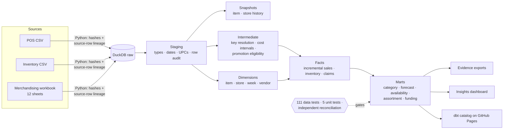
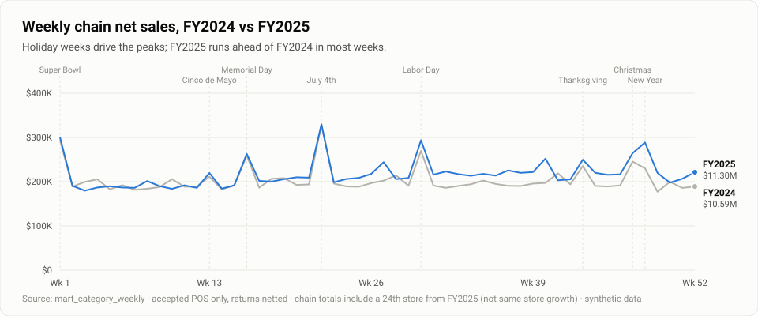
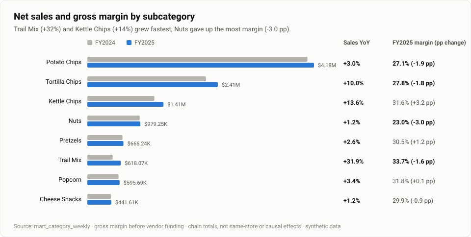
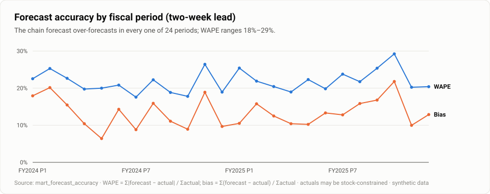
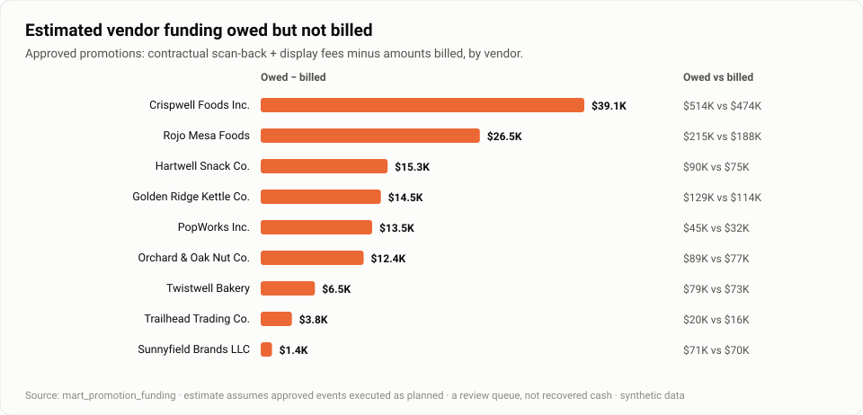

# Bramblewood Retail Analytics Warehouse

**Turning disconnected POS, inventory and merchandising extracts into a tested, auditable retail warehouse — built with dbt, DuckDB, SQL and Python.**

[](https://github.com/Akshith597/bramblewood-analytics-engineering/actions/workflows/ci.yml)
[](https://akshith597.github.io/bramblewood-analytics-engineering/)


[](LICENSE)

**[🧭 Interactive dbt catalog & lineage](https://akshith597.github.io/bramblewood-analytics-engineering/)** · **[📊 Live insights dashboard](https://akshith597.github.io/bramblewood-analytics-engineering/insights.html)** · **[📄 Case study](docs/case_study.md)** · **[🏛️ Design decisions](docs/architecture.md)** · **[🧾 Decision memo](docs/decision_memo.md)**

> **Synthetic portfolio project.** The dataset was generated by AI ([provenance](data/SOURCE_README.md)); all companies and transactions are fictional. Figures describe that dataset; they are not real client outcomes, recovered funds or realized savings.

<!-- Generated by analysis/build_public.py from analysis/readme_template.md. Do not edit README.md by hand: CI regenerates it and fails on any difference. -->

## At a glance

| | |
|---|---|
| **What I built** | A dbt warehouse that turns three disagreeing source extracts into reconciled, contract-enforced facts and marts, rebuilt and verified by CI on every change |
| **Stack** | SQL · dbt-core · DuckDB · Python (ingestion, verification, charts) · GitHub Actions · GitHub Pages |
| **Data** | 273,376 POS rows, weekly store inventory and a 12-sheet merchandising workbook: 24 stores, 104 weeks, keys and date formats that don't agree |
| **Warehouse** | 35 dbt models (staging → intermediate → marts), an incremental sales fact, Type 2 snapshots, source freshness checks, 13 enforced contracts, 116 automated checks; sales reconciled to the cent against an independent Python rebuild |
| **Reviewer path** | About ten minutes: [the problem](#the-problem) → [warehouse design](#warehouse-design) → three models ([row audit](models/staging/stg_pos_audit.sql), [cost intervals](models/intermediate/int_item_cost_intervals.sql), [`fct_sales`](models/marts/fct_sales.sql)) → two tests ([reconciliation](tests/pos_reconciliation.sql), [incremental change cases](scripts/verify_incremental.py)) → [validation results](#validation). The [lineage graph](https://akshith597.github.io/bramblewood-analytics-engineering/) shows the same path visually |
| **Optional extension** | Statistical answers to the brief's five business questions and a +$308.6K scenario-estimated FY2026 plan ([below](#optional-extension-business-analysis)) |

## The problem

A fictional 24-store retailer needs consistent answers about sales, inventory, promotions and vendor funding. Disconnected extracts use different keys, dates and grains; naive joins duplicate revenue and distort decisions.

## Warehouse design



Only staging models read raw sources, intermediate models never read marts, and every mart has an enforced contract and a typed, documented column list; CI checks these rules against the dbt manifest. Design decisions are recorded as ADRs in [docs/architecture.md](docs/architecture.md); grains and metric definitions are in [docs/data_contracts.md](docs/data_contracts.md).

## Engineering decisions that mattered

| Source issue | Decision | Verified result |
|---|---|---|
| Concatenated POS feeds | Classify every row; remove exact replays only | 113 replay rows (**$8,489.86**) excluded; one embedded header retained in audit |
| Inconsistent product/date formats | String UPC normalization and two explicit date formats | 30,985 UPCs padded; 83,351 legacy-format dates parsed |
| Overlapping cost history | Latest-start precedence; original dates kept with an exception flag | 34 affected sales rows; **$29.12 COGS sensitivity** disclosed |
| Return transactions | Preserve signed units and amounts | 160 return rows retained instead of dropped as "invalid" |
| Inventory without sales | Keep both sides with presence flags | 1,888 inventory-only observations remain visible |
| Forecast at chain grain | Aggregate actuals to chain SKU-week before joining | No store-level fanout in forecast measures |
| Swapped promotion dates (one event) | Order the dates once in `stg_promotions`, keep the source dates and a flag | Warehouse funding and every analysis read the same window; a unit test and a singular test guard it |
| Blank inventory quantities, colliding source names | Fail loudly: not-null contract on stock and receipts; ingestion rejects two extracts that map to one raw table before loading | Neither occurs in the supplied data; both are covered by fixture tests |
| Many claims per promotion | Aggregate claims and eligible units before joining funding terms | Funding gap computed without double counting; cancelled-event claims ($974.65) kept separate |

The most instructive failure: the cost-overlap test initially failed for `SS-1081`, whose old cost ended two weeks *after* the new one began. A direct join would have duplicated sales rows and inflated revenue. The fix closes each cost period the day before the next one starts and keeps the source dates beside it ([`int_item_cost_intervals`](models/intermediate/int_item_cost_intervals.sql)):

```sql
    case
        when next_start is not null and (effective_end is null or effective_end >= next_start)
            then next_start - 1
        else effective_end
    end as effective_end,
    next_start is not null and (effective_end is null or effective_end >= next_start) as overlap_adjusted,
```

The full story is in the [case study](docs/case_study.md#the-most-instructive-failure).

## Reconciliation

- **Every source row is accounted for.** 273,376 POS rows become 273,262 accepted rows; each exclusion has a disposition in the [row audit](models/staging/stg_pos_audit.sql) and keeps its source file and row number.
- **Sales tie out to the cent.** $21,886,423.88 across 2,427 store-weeks matches an [independent rebuild](scripts/independent_reconcile.py) that reads the raw CSV with Python `csv` and `Decimal`, without reusing the transformation SQL. [Receipt](evidence/independent_reconciliation.json)
- **The fact table cannot silently drop or duplicate rows.** A singular test fails the build if row count, net sales or units in `fct_sales` differ from the accepted POS rows ([`tests/pos_reconciliation.sql`](tests/pos_reconciliation.sql)):

```sql
select 'row_count_or_money_mismatch' as failure
where
    (select count(*) from {{ ref('fct_sales') }}) != (select count(*) from {{ ref('int_pos_accepted') }})
    or (select sum(net_sales) from {{ ref('fct_sales') }}) != (select sum(net_sales) from {{ ref('int_pos_accepted') }})
    or (select sum(units) from {{ ref('fct_sales') }}) != (select sum(units) from {{ ref('int_pos_accepted') }})
```

## Incremental loads and history

- **Incremental fact table.** [`fct_sales`](models/marts/fct_sales.sql) restates a date window, not just the week keys present in new data. A [pre-hook](macros/restate_sales_window.sql) deletes every week ending within the lookback of the latest *source* week, so changed rows, deleted rows and whole deleted weeks are all restated; the model then appends every source row newer than what remains, which loads everything into an empty target. Backdated cost or master-data corrections go through `--full-refresh`. [Design decision](docs/architecture.md#adr-02--deterministic-full-rebuild)

```sql
        delete from {{ this }}
        where week_ending > (
            select max(week_ending) - {{ var('sales_restatement_lookback_days', 28) }}
            from {{ ref('int_sales_enriched') }}
        )
-- ...

    where week_ending > (
        select coalesce(max(week_ending), date '1900-01-01')
        from {{ this }}
    )

```

- **Changed input is tested, not assumed.** [`verify_incremental.py`](scripts/verify_incremental.py) edits copies of the warehouse and runs `fct_sales` incrementally: a changed amount, deleted rows, a deleted week, a deleted latest week and an empty target must each match a full rebuild, and a correction outside the window must be missed until `--full-refresh`. Run against the first version of the model, it catches the deleted-week and empty-target bugs that version had. [Receipt](evidence/incremental_changes.json)
- **Unchanged input rebuilds identically.** [`verify_repeatability.py`](scripts/verify_repeatability.py) hashes the ordered contents of all 35 models after a full build and again after a reload and incremental rebuild; CI fails if any hash differs. [Receipt](evidence/repeatability.json)
- **Type 2 history.** dbt snapshots track item and store master changes on attribute columns only, with tests for one current version per key and non-overlapping validity windows. The publication workflow copies the current release's snapshot tables into each new build, so history accumulates across releases. [Data contracts](docs/data_contracts.md)
- **Source freshness.** `dbt source freshness` warns, then fails, when raw tables stop being reloaded. A separate [publication workflow](docs/runbook.md#validated-batch-publication) checks source hashes and extraction age before atomically switching a release pointer.
- **Portable SQL.** DuckDB-only expressions go through dispatched macros, and an optional Snowflake target compiles the models. It has not run against a live account. [What is ported](docs/architecture.md#running-on-snowflake)

## Validation

- **116/116 dbt checks pass** — 111 SQL data tests and 5 unit tests. [Build receipt](evidence/dbt_build_results.json)
- **Enforced model quality** — 35 dbt models and 13 enforced mart contracts; layer boundaries, staged-source coverage, contracts and column documentation are checked against the dbt manifest. [Receipt](evidence/project_quality.json)
- **Code quality** — dbt-aware SQLFluff, Ruff for Python, pre-commit hooks, macro edge-case tests and chart-helper tests. [Lint receipt](evidence/sqlfluff.json)
- **No stale public claims** — this README, the memo, the plan and the scorecard are rendered from results; CI regenerates them and fails on any difference, a test rejects hand-typed numbers in their templates, and another checks that every SQL excerpt above still matches its source file.
- **CI/CD** — GitHub Actions runs static checks in parallel with the warehouse build; the docs site and dashboard deploy only after the build and reconciliation pass.

## What the marts show

Charts are rendered by [`scripts/build_insights.py`](scripts/build_insights.py) from the tested marts on each build. Sales comparisons use the 22 comparable stores open all 104 weeks without a remodel.



Comparable-store sales grew **+2.6%** — well below the +6.7% chain total, which is inflated by the store that opened in FY2025.



Like-for-like, 5 of 8 subcategories shrank. **Trail Mix (+26%)**, **Kettle Chips (+9%)**, **Tortilla Chips (+6%)** grew; **Nuts** changed sales by −3.1% and margin by −3.2 pp; Potato Chips, the largest subcategory, changed −0.9% and −1.9 pp. Margins are before vendor funding; these are descriptive changes, not causal effects.



The forecast **over-forecasts in every period** (FY2025 bias +13.4%, WAPE 22.5%), using two-week-lead forecasts only; actuals may be stock-constrained.



The upper bound of the funding gap, by vendor: it assumes every approved event and planned display ran. Scan-back on observed units alone accounts for $65.6K of the $133.1K. [Waterfall](evidence/funding_waterfall.csv) · [Sensitivity](evidence/funding_assumption_sensitivity.csv) · [Exception queue](evidence/funding_exception_queue.csv)

## Optional extension: business analysis

Everything above is the analytics engineering work. This section goes further into analyst and data-science territory: it uses the tested warehouse to answer the five questions in the source brief. It is optional reading for analytics engineering roles. All dollar figures are **scenario estimates on synthetic data**, not delivered or realized impact.

The [decision memo](docs/decision_memo.md) answers each question with a dollar figure, a 90% range and a recommendation, or says plainly when the data cannot answer. The methods are explained without jargon in [methods in plain English](docs/methods_explained.md).

| Question | What the evidence supports | Recommendation |
|---|---|---|
| Delist slow sellers? | **Inconclusive.** With four test stores the test cannot detect a gross-profit change under 4.3%, and the same comparison on a fake date a year earlier shows a +2.4% "effect", so large-store seasonality confounds it. What it did measure cleanly: units fell 1.4% but net sales changed only −0.7%, because shoppers switched to the items that stayed (retained items recovered 124% of the lost sales, 83% to 164%). | Don't roll out the test planogram. Treat the 14 SKUs that earn the least gross profit per facing as candidates (+$55.1K a year if the transfer rate holds) and pilot their removal with a store holdout, large-format stores first: the rate was measured in four large stores only |
| Promotions | **Roughly break-even, and only because of vendor money.** FY2025 events net +$13.4K (−$15.1K to +$42.0K) after funding and −$661.0K before it; 1% of events made money on their own. | Drop promotions without a display; keep display events where execution is verified and the fee collected |
| Spring 2025 price increases | **Not identified** by either event design. *Validated:* the break-even elasticities (−2.78 for Golden Ridge, −2.18 for tortilla) are arithmetic on price and cost. *Scenario:* an unvalidated pooled elasticity (−0.52 for kettle, −2.44 for private-label tortilla) puts Golden Ridge far from break-even and tortilla near it. | Keep Golden Ridge's price, assuming the pooled estimate is roughly right; tortilla: roll the price back, a scenario call on small dollars |
| Forecast and in-stock | Over-forecasts by +13.4% (+11.8% to +15.0%) while beating naive benchmarks; a correction learned on FY2024 cut FY2025 bias to +0.5% out of sample. That over-forecast never reached store shelves: receipts follow sales, and the $1.05M of over-forecast units at cost became $19.4K of extra store stock; an inventory replay finds no saving from the correction at equal service (−$941.32). Stock-outs cost an estimated $26.4K of GP ($20.7K to $31.8K, exploratory). | Use the corrected forecast for budgets; leave store replenishment alone |
| Vendor funding | Approved events were under-billed by $65.6K to $133.1K. The low end is scan-back on observed units; the high end also counts display fees for every planned display, which the extracts cannot confirm ran. | Bill the $65.6K scan-back shortfall now; verify displays before billing the display portion |

### The FY2026 plan

The [one-page FY2026 plan](docs/fy2026_plan.md) models a **scenario-estimated annual GP opportunity of +$308.6K after vendor funding** (low to high case +$174.6K to +$442.5K). Drop promotions without a display (+$229.2K), treat vendor funding as a budget to re-negotiate and bill in full (+$14.2K), pilot cutting 14 candidate SKUs on GP per facing and measured demand transfer (+$55.1K, if the large-store transfer rate holds in other formats), keep Golden Ridge's price (+$10.1K with the tortilla call, assuming the unvalidated pooled elasticity), and leave store replenishment alone. The low and high cases set every uncertain input to the pessimistic or optimistic end of its range at once: the 90% intervals of the transfer rate, elasticities and promotion results, plus stated assumptions about how much vendor funding is re-won and how much under-billing is recovered. Unmodeled basket effects, vendor responses and implementation costs are excluded, so the low case is a modeled low case, not a guaranteed lower bound. This is a scenario estimate on synthetic data, not realized savings or a forecast.

**How the analysis is checked.** Estimators recover planted effects in simulated and real data; every headline coefficient and clustered standard error is re-estimated by an independent pure-Python solver and by R `fixest` in CI; CI fails if the memo, the plan, this README or any result drifts from what the queries produce. Every estimate and interval is frozen for the [answer-key scorecard](docs/scorecard.md); no answer key is available, and it is unknown whether one exists, so they are scored only if one is obtained.

**What the analysis plan does and doesn't prove.** The [analysis plan](analysis/PLAN.md) fixed every metric, comparison group and decision rule in its own commit before the first results commit, and every later change is logged as a deviation. It is not a formal pre-registration. The two commits were made about half an hour apart by the same author, and a later author-email correction rewrote the repository's history (new commit IDs; same files, messages and dates). Git timestamps are set by whoever commits, so Git history alone cannot prove when results were first computed.

## How I built this

I built this project with AI assistance (Claude Code). My role was to set the scope and the design choices, direct the implementation, and review and verify the results; I did not write every line by hand. Claude co-authored many of the commits, and the Git history links to those sessions so the process stays visible.

What I decided, and how each decision is checked:

- **Grain and layering.** One row per store, SKU and fiscal week in `fct_sales`, with every model in a staging, intermediate or mart layer. Checked by the layer-boundary and contract checks against the dbt manifest.
- **How dirty source data is handled.** Every row in the engineering-decisions table above keeps its source lineage, and each rule has a dbt test or a published receipt.
- **What counts as correct.** Sales must match an independent rebuild from the raw files to the cent, and an incremental rebuild must match a full build exactly. Both run in CI.
- **What is claimed in public.** Every figure in this README is rendered from build results, and the limitations below are stated rather than left out.

These checks are evidence about correctness. They do not prove who typed each line, and they do not validate every business assumption. Design choices and their tradeoffs are recorded in the [architecture decisions](docs/architecture.md).

Python is the larger share of the code because it covers ingestion, independent verification, charts, document generation and the optional statistical extension. The warehouse itself is the SQL in [staging](models/staging/), [intermediate](models/intermediate/) and [marts](models/marts/).

## Run it locally

Python 3.12; no cloud account or credentials required.

```bash
python -m venv .venv
# Windows: .venv\Scripts\Activate.ps1   macOS/Linux: source .venv/bin/activate
python -m pip install -r requirements-dev.txt
python scripts/run_all.py               # ingest → freshness → dbt build → reconcile → docs → evidence → charts
python scripts/verify_repeatability.py
python -m analysis.run                  # optional: analyses → analysis/results → memo, plan, scorecard, README
python -m unittest discover -s tests_python -v
python scripts/lint_sql.py
```

Browse lineage and compiled SQL locally with `python scripts/invoke_dbt.py docs serve --port 8080`, and open `target/insights.html` for the dashboard. See the [runbook](docs/runbook.md) for troubleshooting.

## Scope and limitations

This is a local batch warehouse, not a deployed production platform, and it does not demonstrate production operating experience: there is no live scheduler, access control, monitoring, alerting, recovery drill or cloud run behind it. Item and store dimensions reflect the supplied current master; snapshots record changes only from the first build (carried across published releases), and cost, price and planogram periods are effective-dated. Cost precedence is a documented assumption. A zero-stock snapshot does not establish lost sales, and approved promotion eligibility does not establish realized lift or funding entitlement. Source-owner exception resolution, alert delivery and managed scheduling remain future work. See the [design decisions](docs/architecture.md) for the tradeoffs.

## Repository map

```text
data/raw/             AI-generated synthetic CSV and Excel inputs (see data/SOURCE_README.md)
models/staging/       Parsing, normalization, row audit and unit fixtures
models/intermediate/  Key resolution, cost intervals and promotion eligibility
models/marts/         Dimensions, facts and business marts (contracts enforced)
snapshots/            Type 2 history of the item and store masters
tests/                Singular SQL assertions: temporal, arithmetic, reconciliation, snapshot validity
tests_python/         Macro, evidence-reference, chart-helper and public-claim guards
macros/               UPC normalization, cross-database helpers and a generic period-overlap test
scripts/              Ingest, build, verification, publication, evidence export and charts
analysis/             Optional extension: analysis plan, estimators, FY2026 plan model, frozen estimates and scorer
docs/                 Architecture ADRs, data contracts, runbook, case study, memo, plan, scorecard
evidence/             Executed results and machine-readable validation receipts
.github/workflows/    CI quality gate and GitHub Pages deployment
```

The raw extracts in `data/raw/` (about 20 MB) are committed as ordinary Git files on purpose: a plain clone rebuilds everything offline, with no Git LFS setup or download step. The files never change, so they don't grow the history.

## Author

**Akshith Reddy** · [Another project: Meridian sales performance](https://akshith597.github.io/meridian_sales_portfolio/) · [GitHub @Akshith597](https://github.com/Akshith597) · feedback welcome via [issues](https://github.com/Akshith597/bramblewood-analytics-engineering/issues)

Project code is released under the [MIT License](LICENSE). The synthetic dataset in `data/` was generated by AI and is not covered by that license; see [data/SOURCE_README.md](data/SOURCE_README.md) for provenance.
