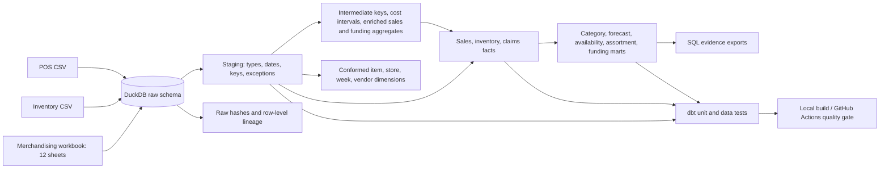

# Architecture and design decisions

## Data flow

## ADR 01 — DuckDB + dbt + a small Python loader

**Decision:** Python only reads formats and records provenance; SQL owns business transformation. dbt owns dependencies, tests and catalog generation. DuckDB provides a local analytical warehouse.

**Why:** The extracts are small enough for a laptop and have no live API, CDC stream or source modification timestamp. A reviewer can reproduce the warehouse without cloud credentials. Queryable raw data makes reconciliation inspectable.

**Tradeoff:** This is not a multi-user production service. There is no scheduler, secrets service, warehouse RBAC or production monitoring. A cloud migration would retain the model DAG while adapting SQL, ingestion and deployment.

## ADR 02 — Deterministic full rebuild

**Decision:** Replace raw tables transactionally, then build the entire bounded history. Source hashes identify exactly which bytes were loaded. A separate test hashes every ordered model before and after reload.

**Why:** Incremental append based on sales week would miss backdated costs, returns and corrected old extracts. The supplied files contain no reliable update timestamp.

**Tradeoff:** Work scales with historical volume. For larger sources, add file manifests plus batch IDs, source-updated timestamps, merge keys, affected-partition recomputation, and atomic promotion of a validated warehouse. Do not use the maximum sales date as a universal watermark.

## ADR 03 — Keep grain explicit

**Decision:** Chain forecasts join chain SKU-week actuals. Claims aggregate to promotion before joining promotions. Inventory retains its own grain. Planograms and price/cost tables use tested temporal joins.

**Why:** Directly joining chain forecasts to store sales or claims to multiple eligible sales rows would inflate metrics. SQL measures should be safe before visualization.

**Tradeoff:** More models and explicit joins are easier to audit than one wide denormalized table with ambiguous measures.

## ADR 04 — Disclose cost ambiguity

**Decision:** Latest-start cost precedence, with the original end date and an adjustment flag retained. The source overlap is exposed in the evidence exports. Other period overlaps are build failures.

**Why:** A raw temporal join initially failed the quality gate. An explicit rule makes the warehouse usable while preserving uncertainty. The sensitivity export measures the exact financial difference from keeping the prior cost.

**Production next step:** Confirm the policy with merchandising or finance, attach a source-owner ticket, and version the correction. The current project has no such confirmation.

## ADR 05 — Nulls are information

**Decision:** Use a full outer sales/inventory mart and preserve missing sales on scheduled planogram rows. Approved promotions lacking claims become review flags.

**Why:** Missing extraction, genuine zero demand, unavailable stock and an unexecuted plan are different states. Defaulting them all to zero would encode an unsupported business claim.

## Failure and publication boundary

`scripts/run_all.py` exits nonzero on a failed ingestion, dbt build or independent reconciliation. Evidence exports occur only after those gates pass. dbt's local builds are not transactionally published as an entire DAG: a failed build may leave some refreshed tables. Consumers must treat failed builds as unpublished; a production implementation should build in an isolated schema/database, validate it, then switch the consumer alias atomically.

`scripts/verify_project.py` rejects raw-source reads outside staging, intermediate dependencies on marts, missing staging coverage, undocumented columns and unenforced mart contracts. The reusable overlap test, UPC macro and pinned dbt_utils package are checked alongside the dbt build.

The GitHub Actions workflow runs the complete build, independent reconciliation, repeatability, macro guards, SQLFluff and pre-commit. Deployment remains gated behind the warehouse build. Remote execution status is recorded separately in the repository and delivery evidence.
